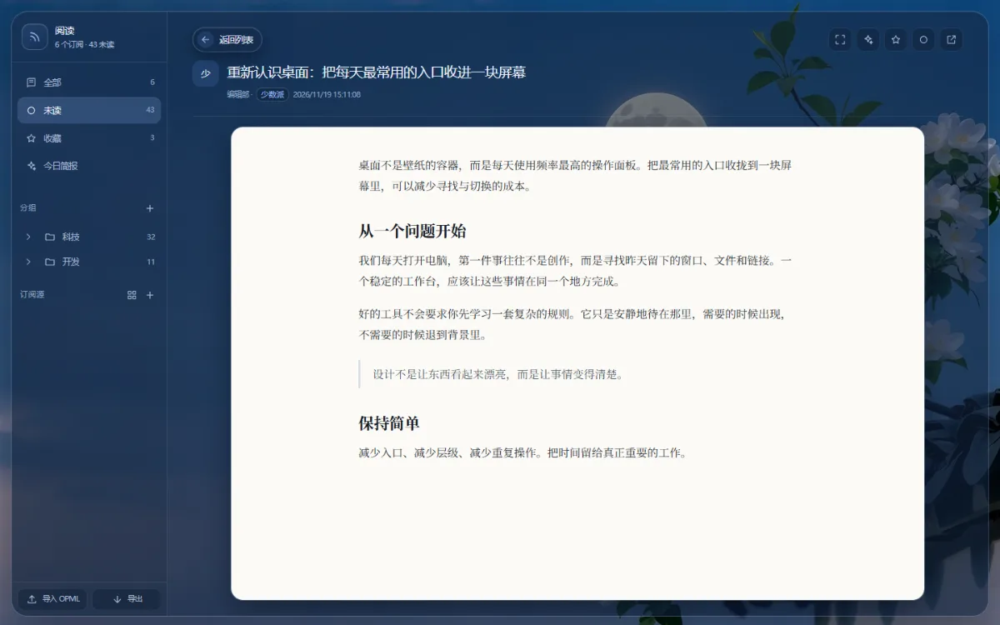

# Ekko Tools

Ekko Studio 的可扩展工具插件。当前提供翻译、邮件与阅读，后续会继续加入更多工具。

## 功能

### 翻译

- 中英自动识别，停止输入后自动翻译
- 支持宿主模型、百度、DeepL 与 OpenAI 兼容服务
- Studio 任意页面划词翻译，中英选区自动互译
- 邮件正文原地翻译，支持术语表、重试与本地缓存

### 邮件

- 163、QQ、Gmail、自建 IMAP/SMTP 多账号统一收件箱
- IMAP 收信、SMTP 回复，支持原邮件一键回复
- 搜索、未读与附件筛选、远程图片、已读同步
- 账号凭据仅加密保存在本机

### 阅读

- RSS、Atom、JSON Feed，支持 OPML 导入导出
- 内置 27 个高热度订阅源，支持分类、搜索、收藏与未读
- 正文提取，可调整字体、字号、行高、宽度与自定义 CSS
- AI 摘要与今日简报，文章缓存到本地数据库

| 邮件 | 阅读 |
| --- | --- |
|  |  |

## 安装

在 [Releases](https://github.com/MyHHDog/ekko-tools/releases) 下载安装包，在 Ekko Studio
插件中心安装或更新。无需 Node.js、npm 或构建。

## 扩展

插件采用模块化视图、宿主 RPC 与契约校验，后续可继续增加待办、日历、笔记、文件转换、
自动化等工具，不影响现有模块。

## 数据

安装包不包含数据库、邮箱、订阅或密钥。首次使用后数据只写入 Studio 私有目录，
邮箱凭据加密保存在本机 vault。

## 开发

需要 Node.js 22+：`npm ci --include=dev --ignore-scripts && npm run build && npm test`
